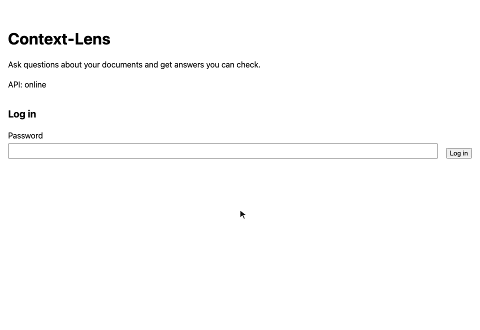
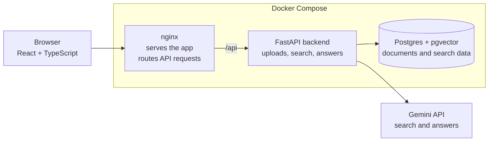
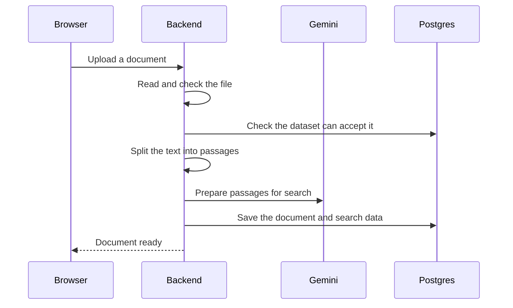
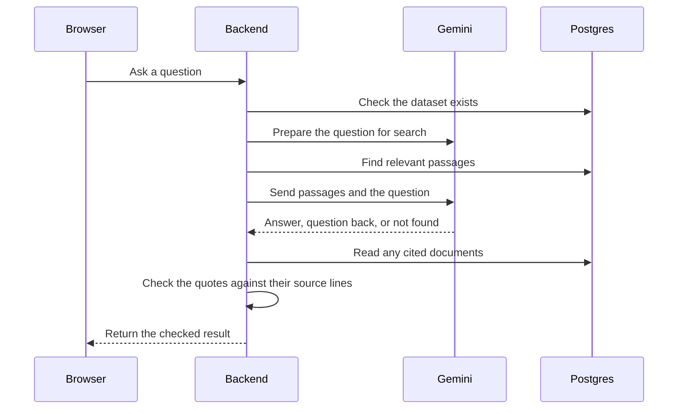

# Context-Lens

Ask questions about your documents and check the exact quotes behind each answer.

Upload your notes, policies, or guides into a dataset - a named collection of documents - and ask about them in plain language. Context-Lens searches that collection, answers with sources you can open, and can ask a question back when it needs more context.




## What you can do

- **Keep documents together.** Create datasets and add text, Markdown, or PDFs containing readable text. Choose several files at once or drag them into the sidebar.
- **Ask across a collection.** Ask a question about the selected dataset without choosing an individual file.
- **Check the sources.** Each answer includes quotes linked to their lines, or pages for a PDF. Open a source beside the answer to read the surrounding text.
- **Get a question back.** When the answer depends on your situation, the app can ask for clarification and show the sources behind that question.
- **Review your session.** Questions stay in separate cards while the page is open. Each new question is answered independently.
- **Use it on your device.** The layout adapts to desktop and phone screens, with light, dark, and system themes.

Before showing an answer or a clarifying question, the backend checks its quotes against the source lines. If a citation fails the check, or the model cannot find an answer in the passages it receives, the app returns “not found”.

## About this project

This is a learning project. My main goal is to understand how RAG and FastAPI work, while developing backend skills through document processing, API design, database storage, testing, and evaluation.

**The frontend was created by Claude.** My learning focus is the backend and the RAG workflow.

## Try it locally

You need [Docker](https://docs.docker.com/get-docker/) and a [Gemini API key](https://aistudio.google.com/apikey).

Clone the project and create your settings file:

```bash
git clone https://github.com/DeniisPyr/Context-Lens.git
cd Context-Lens
cp .env.example .env
```

Open `.env` and set:

```dotenv
GEMINI_API_KEY=your_gemini_api_key
ACCESS_PASSWORD=your_chosen_password
```

Start the app:

```bash
docker compose --profile app up -d --build --wait
```

Open [http://127.0.0.1:8080](http://127.0.0.1:8080), log in with your chosen password, and:

1. Create a dataset.
2. Add your documents.
3. Ask a question and open a source to check its quote.

Documents stay in the local database between restarts. Their text and your questions are sent to Gemini for search and answers, which uses your API credits.

To stop the app:

```bash
docker compose --profile app down
```

If it does not start, check `docker compose --profile app logs`. For running the backend and frontend separately, see the [development guide](docs/development.md).

## How it works

Context-Lens uses **retrieval-augmented generation (RAG)**: it finds relevant passages first, then gives those passages to the model to answer from.

The app uses React and TypeScript for the interface, FastAPI for the backend, Gemini for document search and answers, and Postgres with pgvector to store documents and their search data. Docker Compose runs these parts together.



### When you upload a document

The backend reads the file, splits its text into smaller passages, and asks Gemini to prepare those passages for search. It saves the document and its search data together.



### When you ask a question

The backend searches the selected dataset for relevant passages. Gemini receives those passages and your question, then returns an answer, a clarifying question, or “not found”. The backend checks any quotes before sending the result to the page.



For the implementation details, see [architecture](docs/architecture.md).

## How it is evaluated

The project includes **78 questions about seven fictional documents**, with checks for expected facts, citations, missing information, and clarifying questions.

In the saved evaluation, each question was asked three times. The RAG approach passed **215 of 233 completed runs (92%)**, including all **60 runs** where the documents had no answer. One run ended in an API error and is excluded from that score.

The evaluation also compares search with giving the model the relevant documents in full. The [evaluation guide](docs/evaluation.md) explains the methods, results, and where the approaches differ.

## More documentation

- [Development guide](docs/development.md) - run the services separately, use the API, and run the checks.
- [Architecture](docs/architecture.md) - document processing, search, citation checks, and design decisions.
- [Evaluation](docs/evaluation.md) - question set, comparison method, and saved results.
- [Deployment and troubleshooting](docs/operations.md) - access settings, deployment notes, and current limitations.
