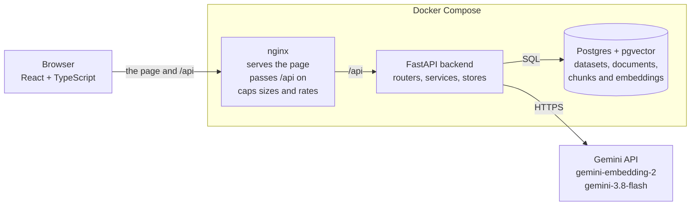
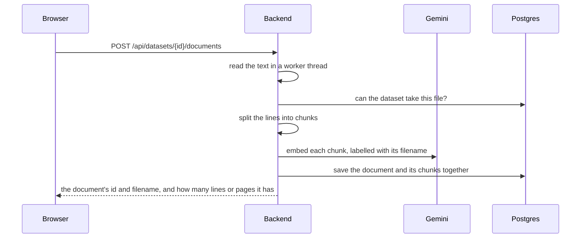
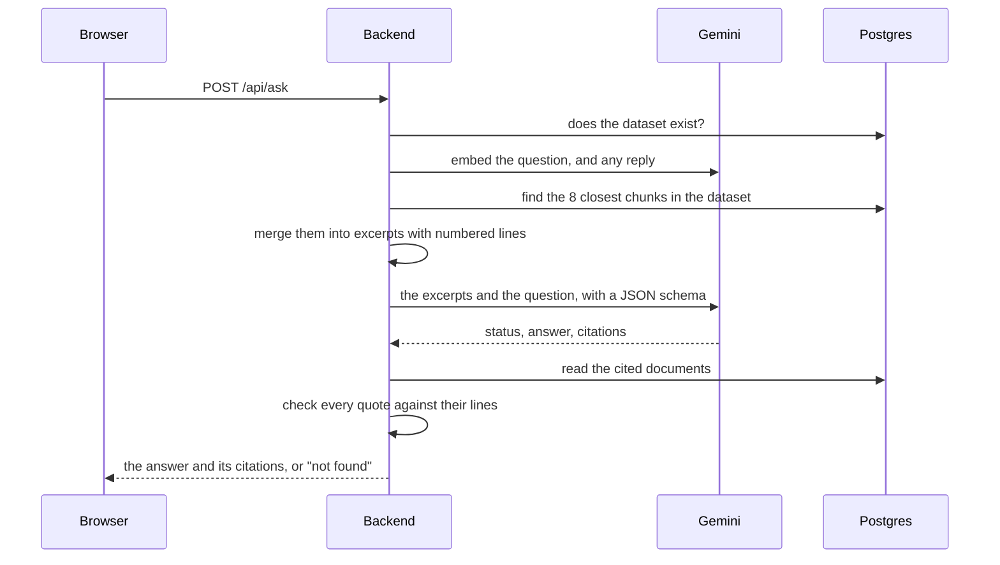

# Architecture

[Back to the README](../README.md)




In development, Vite serves the page and passes `/api` on instead of nginx. The backend is split by job. Routers only turn HTTP requests into calls. Services hold the logic and don't import FastAPI. The stores in `db/` are the only code that knows SQL, and `clients/gemini.py` is the only code that talks to Gemini.

An upload is checked, chunked and embedded before anything is saved:



A question is searched, answered and checked:



[How a question is answered](#how-a-question-is-answered) has the details.

### Design decisions

- **Check, don't trust.** Citations are checked by code, not by another model. Each quote must be word for word in the lines it cites, and those lines must be among the ones Gemini was shown. One failed citation turns the whole answer into "not found": a wrong "not found" does less harm than a wrong answer that looks sourced.
- **Line numbers everywhere.** A document is a list of numbered lines, and chunks, excerpts, citations and the viewer all find lines by those numbers. A PDF's lines are numbered through the whole file, and the line each page starts on is stored with it, so PDFs go through the same pipeline. Only what the user sees differs: the page, with lines counted from 1 on each page.
- **The schema sets the rules.** Gemini must answer in JSON that matches a Pydantic model. The answer to a reply uses a model without the "ask back" status, so a user is asked one question at most, whatever Gemini makes of the prompt.
- **No connection waits for Gemini.** The stores finish their transactions before a Gemini call and start new ones after it, so none stays open while Gemini works. An upload or a question that the database would refuse is refused before any credits are spent.
- **Exact search.** A dataset holds at most 100 documents by default, so Postgres compares the question with every chunk of the dataset. That's fast at this size and never misses a closer chunk. A vector index such as HNSW is the next step for bigger datasets.
- **Request storage.** Answer requests use `store=False` to opt out of storage by Gemini's Interactions API. Embedding requests, which carry each chunk and each question, have no equivalent option in this client.
- **Measured changes.** Changes to search and to the prompt are judged on the evaluation set. It's graded by plain text matching, so the same answers always get the same scores.
- **A stateless login.** The session cookie holds an expiry, signed with a key derived from the password. The server keeps no sessions, and changing the password ends them all.

## Database

Documents live in Postgres, so uploads survive a backend restart. Each one belongs to a dataset, and a filename can only be in a dataset once. Deleting a dataset deletes its documents with it, and a deleted dataset's name or document's filename can be used again. Everything except the health check needs Postgres. While Postgres is down those requests answer 503, and they work again once it's back, without restarting the backend. If the migrations haven't been applied, the 503 gives the command to run.

After pulling a change that adds a file to `backend/migrations/versions/`, apply the migrations again:

```bash
cd backend
uv run alembic upgrade head
```

Documents you already have move to a dataset named `My documents` when the migration that adds datasets runs, and any duplicate filenames among them get a number, as in `notes (2).txt`.

### PDF files

A PDF's text is read page by page with [pypdf](https://pypi.org/project/pypdf/). Its lines are numbered through the whole document, as a text file's are, so search and the citation check work the same way. The line each page starts on is stored with the document. A citation of a PDF names its page, such as "Page 2", and the line viewer shows a "Page" row where each page starts, with lines numbered from 1 on each page.

- **Text only:** a scanned PDF has no text to read, so it's refused. So is one that needs a password; one that only restricts copying or printing is read.
- **Size:** the file must be under 1 MB like any upload, and so must its text. A well-compressed PDF can hold far more text than its size, and every line of it is embedded.
- **Pages and time:** a PDF can have at most 1,000 pages, and reading stops after 20 seconds. Reading runs in a worker thread, so other requests are served meanwhile. One page can still take a few seconds past the limit, though, and a read can't be cancelled.
- **Layout:** the text comes out as pypdf reads it, so columns, tables and hyphenated words may not read as they do on the page. The spaces a PDF pads its lines with are dropped.
- **Logs:** pypdf's own log messages can quote the file, so none of them are logged.

### Chunks and embeddings

An upload also prepares the document for search:
- **Chunks:** the text is split into chunks of whole lines, up to 1,000 characters each. A chunk ends at a blank line where it can, so a paragraph or list entry stays whole and a heading stays with the text under it.
- **Embeddings:** Gemini's `gemini-embedding-2` turns each chunk, labelled with its filename, into 768 numbers. They're stored with the chunk and its line numbers in the `chunks` table, using pgvector.
- **All or nothing:** the document and its chunks are saved together. If Gemini is unavailable or fails, the upload is refused and nothing is stored.
- **Deleting:** deleting a document or a dataset deletes its chunks too.
- **Cost:** embedding spends credits on every upload, about 5 cents for a 1 MB file at November 2026 prices. So a dataset holds at most 100 documents; to change that, set `MAX_DOCUMENTS_PER_DATASET` in `backend/.env`. An upload that would be refused, such as a duplicate filename or one into a full dataset, is refused before anything is sent to Gemini.

The 1,000-character size comes from a comparison on the evaluation set, when it had 48 questions. Each of its 32 answerable questions was searched against the chunks of all 7 documents, looking for the chunk that holds each of the 40 passages the answers come from.
- **Size:** of 600, 1,000 and 1,500 characters, 1,000 ranked those chunks highest. It put them first for 57% of the passages, in the top 3 for 88%, and in the top 10 for all of them.
- **Filename label:** labelling each chunk with its filename helped at every size. At 1,500 characters it raised the share in the top 5 from 72% to 98%.

Documents uploaded before chunks existed have none. After applying the migration that adds them, index those documents once. This calls Gemini, so `--dry-run` first shows how much text it would send:

```bash
cd backend
uv run python -m context_lens.index_documents --dry-run
uv run python -m context_lens.index_documents
```

It only touches documents without chunks, so running it again is safe and retries any that failed.

The data lives in a Docker volume, so it survives `docker compose down`. To wipe it, run `docker compose down -v`, which deletes everything in the database. The defaults work as they are. To change them, see `.env.example` in the repo root and `DATABASE_URL` in `backend/.env.example`.

## How a question is answered

A question is asked of a whole dataset, in four steps:

1. **Search:** Gemini embeds the question, labelled `task: search result | query: …`, and Postgres finds the 8 chunks of the dataset closest to it by cosine distance. It's an exact scan without a vector index, which is fast at this size and never misses a closer chunk. To change the number of chunks, set `CHUNKS_PER_QUESTION` in `backend/.env`.
2. **Excerpts:** the chunks are grouped by file and put in line order, with neighbouring chunks merged, and every line keeps its number.
3. **Answer:** Gemini answers from these excerpts only, and gives each claim a citation with the file, the lines and a quote copied from them.
4. **Check:** each quote must be word for word in the document's real lines, and those lines must be among the ones Gemini was shown. A citation whose range is wider than its quote is narrowed to the lines the quote is on. If any citation fails, the whole answer is replaced with "not found".

In step 3, Gemini can ask a clarifying question instead of answering, when the excerpts answer the question differently for different situations, the question doesn't say which one the user is in, and listing every answer wouldn't make a short, clear reply. "How do I report a problem?" is one: a lost laptop, a LIMS outage and a faulty instrument each have their own way. The clarifying question cites the lines that show the different answers, and step 4 checks those citations like an answer's.

The reply is sent with the question and the clarifying question. Search then embeds the question and the reply together, so it looks for the lines about the situation the reply names, and the prompt ends with all three. This time Gemini can only answer or say "not found", because the answer format it's given has no status for asking again. So a user is asked one question at most, and the conversation can't loop.

A dataset without chunks gets "not found" without asking Gemini for an answer; only the question is embedded. That includes documents uploaded before chunks existed and not yet indexed (see [Chunks and embeddings](#chunks-and-embeddings)).
